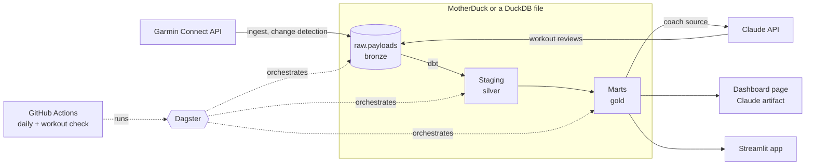
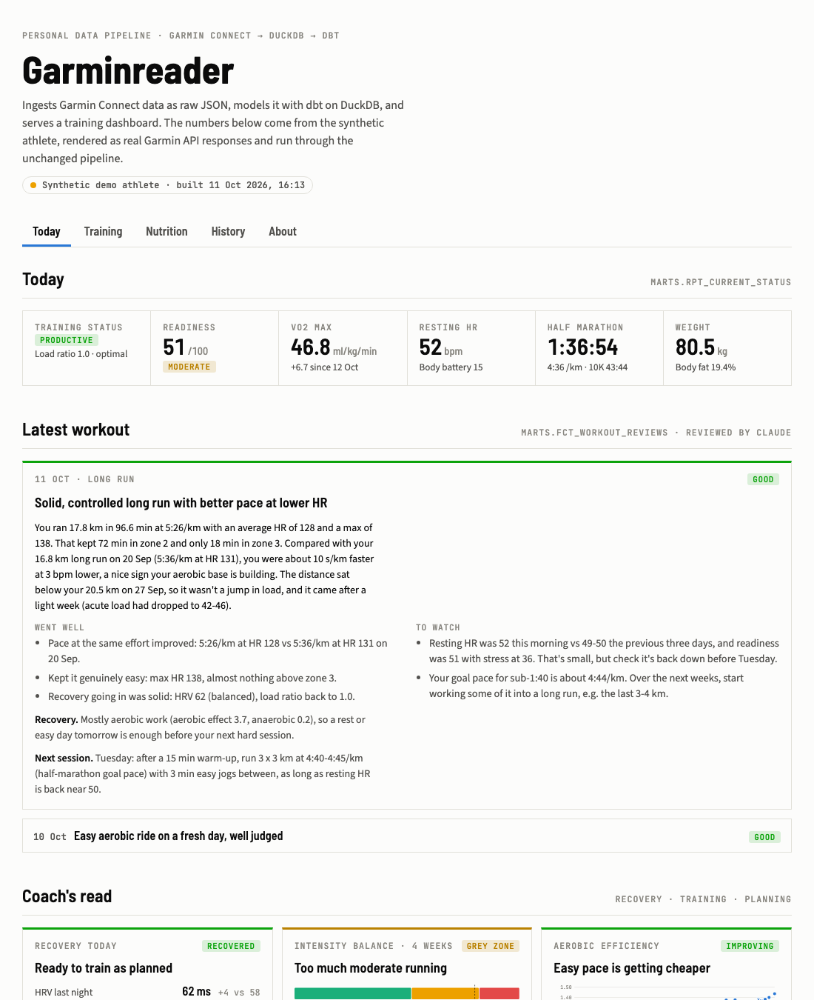
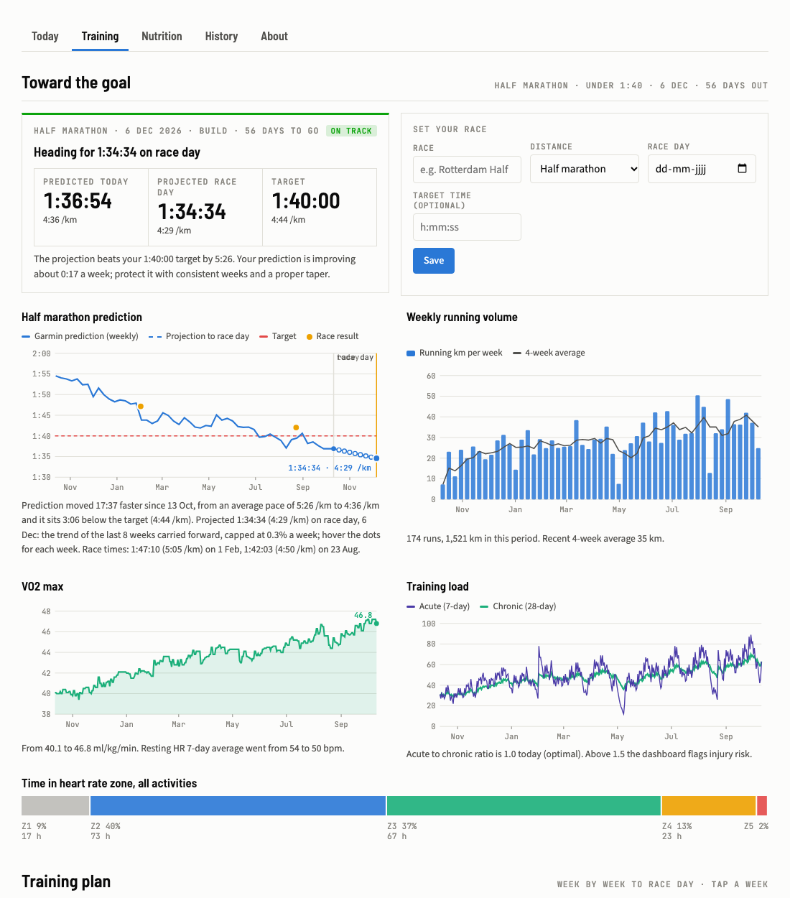
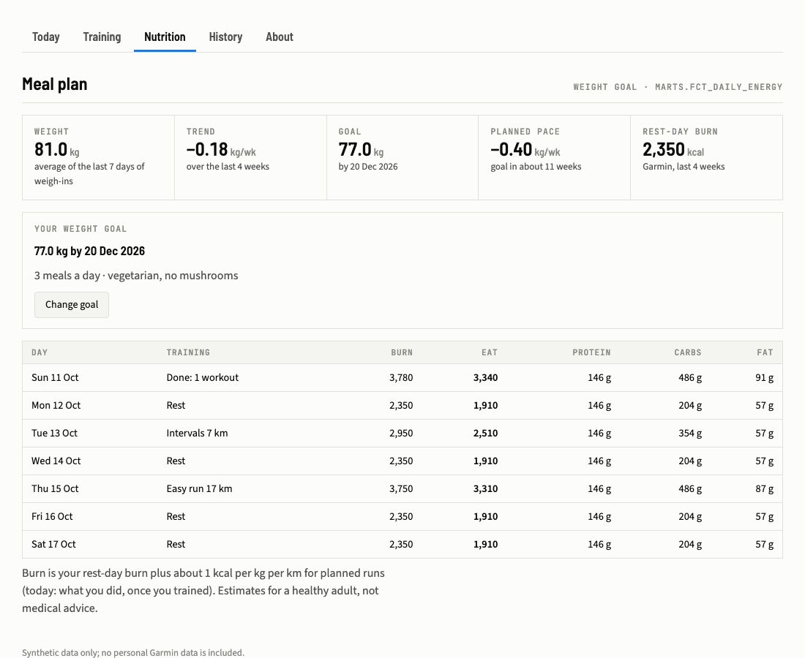
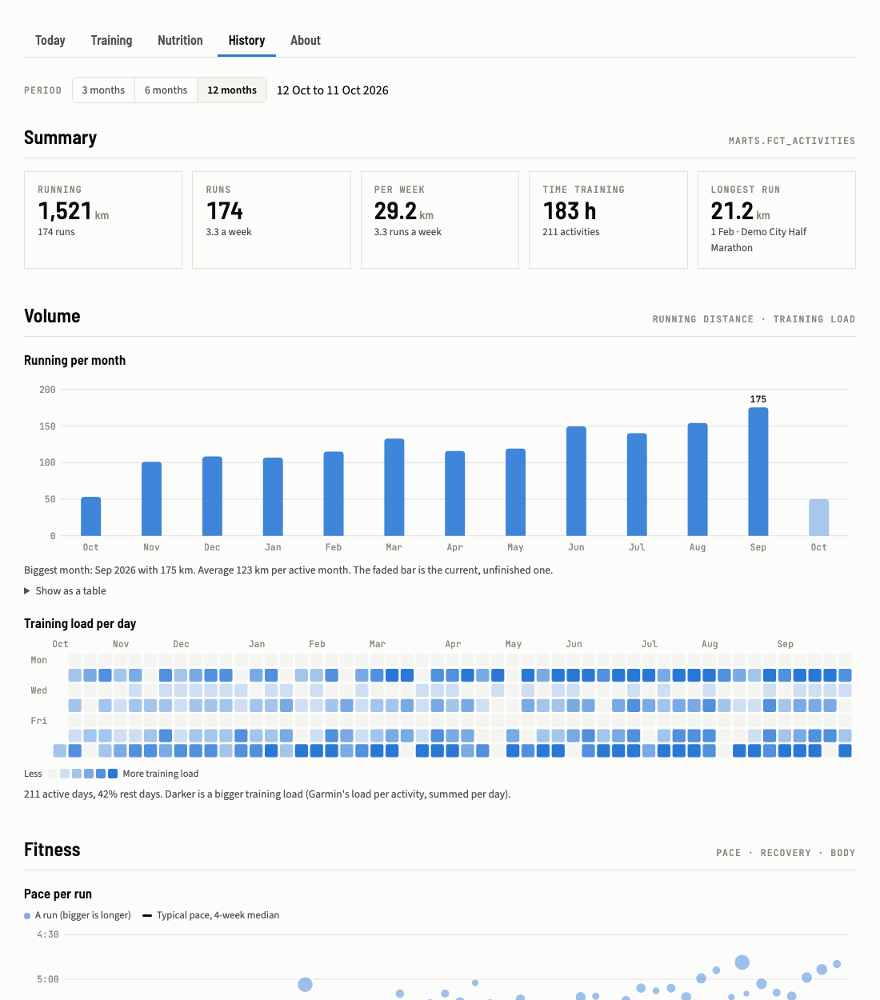
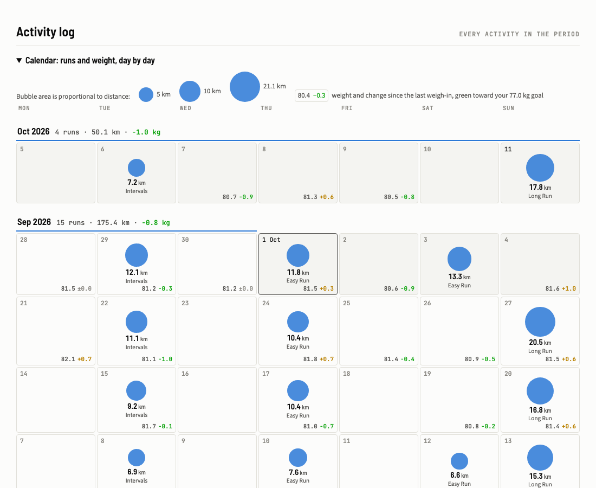

# garmin_project

A personal data platform for training data. It ingests my Garmin Connect data into MotherDuck (or
a local DuckDB file), models it with dbt, orchestrates it with Dagster, has Claude review every
workout, and serves it in a live training dashboard: one HTML page published as a Claude artifact.

It is a real, daily-used pipeline, built the way I would build one at work: raw data kept as an
append-only, replayable bronze layer, every transformation in tested dbt models, and refreshes that
run in the cloud within the hour after a workout, without ever logging in with a password.

## Architecture



| Layer | What it is |
|---|---|
| **Ingest** | One pluggable `Source` per system, registered in [`sources/__init__.py`](src/garminreader/ingest/sources/__init__.py). The Garmin source makes one record per API call and keeps the payload untouched. The coach source reads the marts, asks Claude to review each workout without a review, and stores the answer the same way. A source only fetches; it never transforms. |
| **Bronze** | Append-only `raw.payloads` (payload and params as JSON, plus load metadata) and a `raw.loads` run log. A record is stored only when it is new or changed, and a load commits with its run-log row in one transaction. Every model can be rebuilt from this table. |
| **Silver, gold** | dbt. Staging keeps the newest version of each record. Marts: daily health, daily energy, activities, Garmin Coach workouts, body composition, race results with personal bests, race predictions, workout reviews, current status, heart rate zones, and data freshness reports. Every model has data tests, plus a dbt unit test for race detection. |
| **Orchestration** | Dagster: raw ingest as daily partitions (backfill or rerun any day), each dbt model as an asset with its tests as checks, the review step between the two halves of dbt (Dagster splits the dbt run around it), and freshness checks. |
| **Serving** | The dashboard page ([`snapshot/`](src/garminreader/snapshot/)), and a Streamlit app for local use ([`dashboard/`](src/garminreader/dashboard/)) with its own AI coach. Both read marts only. |

## Engineering choices worth a look

- **An append-only raw layer.** Change detection compares each payload with the latest stored
  version of the same source, endpoint and params, so overlapping re-fetches store nothing new
  while real changes are kept as history ([storage.py](src/garminreader/ingest/storage.py)).
- **AI output as a source.** Claude's reviews land in `raw.payloads` like any API response and are
  modelled by dbt, so a review is written once, kept, and traceable to the model and prompt version
  that wrote it ([coach/](src/garminreader/ingest/sources/coach/)).
- **Numbers by code, words by Claude.** The meal plan's targets are computed from measured data
  with fixed limits; Claude only turns them into meals. The workout review prompt gets the session
  and its context as tables and must cite the numbers it uses.
- **Cloud refreshes without a password.** The workflow only resumes a Garmin session created on my
  own machine and writes a refreshed session back to its secret; it never tries a password login,
  which is what makes Garmin ask for MFA or lock an account.
- **Few calls to an unofficial API.** The workout check asks Garmin only during training hours and
  stops once today's workout is in: at most about 100 calls a day.

## The dashboard



*All pictures show a simulated athlete, not personal data.*

One self-contained page in five tabs. It holds no data itself: opened on claude.ai, it queries the
marts through the viewer's MotherDuck connector, refreshes every 15 minutes while open, and keeps
the goals you enter in the artifact's own database.

**Today.** Training status, readiness, VO2 max, resting heart rate, race prediction and weight;
Claude's review of the latest workout (what the session was, whether it fit your recent load and
recovery, how it compares with similar runs, and what to do next); and a coach's read on recovery,
plan adherence, intensity balance, aerobic efficiency, load progression, long runs, endurance,
sleep, consistency, training paces and next week. Every card says what it rests on (nights, runs or
weeks of data) and how confident that makes it; a low-confidence card is drawn quieter.

Plan adherence compares the plan with what you ran over the last four weeks: sessions done, key
sessions hit (80% of a long run, time in zones 4 and 5 for intervals, zones 3 to 5 for threshold),
planned against run distance, Garmin Coach's workouts done, and the weekday the misses cluster on.
The page rebuilds its plan from the data on every view, so it keeps the planned session of each of
the next seven days in the artifact's database, fixed once the day has passed or has a run.

**Training.** A race goal with a race-day projection from the trend in Garmin's predictions and a
training level (Steady, Balanced or Ambitious: how fast volume grows and how much quality work the
plan holds); Claude's read on your potential, which suggests a target time and level from your
fitness and training data and applies them with one click (the plan's own "Recalculate with
Claude's potential" button asks Claude again when the read is missing or out of date, then rebuilds
the plan from its target and level); charts for predictions, volume, VO2 max
and training load; a week-by-week plan to race day with a reason for every session; and a review
of last week, including planned sessions done. When you follow a Garmin Coach plan, the week
shows two columns per day: this page's session, and Garmin Coach's (workout, duration, pace,
training effect, done or missed).



**Nutrition.** A weight goal and a day-by-day meal plan. The page sets each day's energy and macro
targets from Garmin's measured burn, the weight trend, today's workout and the planned sessions,
within fixed limits (at most 0.75% of body weight a week, never under 1,500 kcal or 25% below the
day's burn). Claude then writes meals for those targets, with macros per meal and totals per day
and week.



**History.** One period filter (the last 3, 6 or 12 calendar months, this one included) over everything: summary tiles against the
period before, running volume per month or week, a heatmap of daily training load, pace per run
with its trend, resting heart rate, HRV and weight, when you train, run distances, time per
activity, records, and a filterable activity log. Events you note (illness, injury, travel) and
races from the data are marked on the trend charts in both Training and History, so a dip comes
with its reason.



The tab ends with a calendar of runs and weigh-ins: bubbles sized by distance, and each weigh-in
with its change, green when it moves toward the weight goal.



**About.** How the pipeline works, and how far behind each metric is.

## Run it

You need Python 3.12+, [uv](https://docs.astral.sh/uv/) and a Garmin Connect account.

```sh
uv sync
cp .env.example .env     # GARMIN_EMAIL, GARMIN_PASSWORD; optionally DATABASE=md:garmin, MOTHERDUCK_TOKEN, ANTHROPIC_API_KEY
uv run doctor            # checks Garmin, the database, dbt and Anthropic
uv run ingest garmin --since 2026-01-01   # asks for an MFA code once, then caches the session
uv run pipeline          # ingest, workout reviews, dbt build and checks, as the scheduled run does
uv run snapshot          # the dashboard page with the data embedded: data/snapshot.html
```

### Commands

| Command | What it does |
|---|---|
| `uv run ingest garmin [--since YYYY-MM-DD]` | Garmin into `raw.payloads`; without `--since`, resumes from the last load minus a day. |
| `uv run ingest coach [--since YYYY-MM-DD]` | Claude reviews workouts without a review (the last 7 days, or from `--since`; at most 5 a run). |
| `uv run transform [dbt args]` | dbt against the configured database; `build` by default. |
| `uv run pipeline [--partition YYYY-MM-DD]` | The Dagster job in process: ingest, reviews, dbt build, checks. |
| `uv run dagster dev` | The Dagster UI: lineage, partitions, backfills, check results. |
| `uv run snapshot [--live] [--days N] [--out PATH]` | The dashboard page. `--live` embeds no data and queries MotherDuck when opened. |
| `uv run dashboard` | The Streamlit app. |
| `uv run doctor` | Checks every connection; exits non-zero on a failure. |
| `uv run workout-check` | Prints `new=true` when Garmin's newest activity is not stored yet. |
| `uv run garmin-tokens login\|export` | Creates the Garmin session on your machine, and prints it for the `GARMIN_TOKENS` secret. |

### Publishing the dashboard

```sh
uv run snapshot --live --out data/snapshot.html
```

Publish that file as a claude.ai artifact with the capabilities `mcp` (MotherDuck, tool `query`),
`db` (rule: `settings` read by viewers, written by editors), `user` and `sample`. The page keeps
its state under `settings/`: the race goal (`race`), Claude's read on your potential (`potential`),
the weight goal (`weight`), the last meal plan (`mealplan`), the planned session per day
(`planlog`) and your events (`events`). New data then
appears without republishing; republish only when the page's code changes.

## Scheduled refresh

[`.github/workflows/refresh.yml`](.github/workflows/refresh.yml) runs on GitHub's servers against
MotherDuck:

- **Daily refresh** at 04:17 UTC (about 06:00 in Amsterdam): that day and the day before from
  Garmin (about 18 calls), workout reviews, dbt build and checks.
- **Workout check** every 30 minutes: `uv run workout-check` asks Garmin for the newest activity,
  and the run continues into the full refresh only when `raw.payloads` lacks it. A check asks
  nothing outside 06:00 to 22:00 in Amsterdam, or once a workout from today is stored; the next
  morning's refresh picks up a second one. A failed check shows a warning instead of failing, so a
  broken session fails the daily run once rather than every check.
- **By hand** from the Actions tab, optionally for one day.

GitHub can start scheduled runs late when busy, and pauses the schedules of a public repository
after 60 days without commits (re-enable them from the Actions tab). Runner minutes are free for a
public repository.

### One-time setup

Repository secrets (Settings > Secrets and variables > Actions):

| Secret | What it is |
|---|---|
| `GARMIN_TOKENS` | The Garmin session: `uv run garmin-tokens login`, then `uv run garmin-tokens export \| gh secret set GARMIN_TOKENS` (or paste the export). |
| `MOTHERDUCK_TOKEN` | A MotherDuck access token. |
| `SECRETS_TOKEN` | A [fine-grained personal access token](https://github.com/settings/personal-access-tokens) for this repository only, with *Secrets: Read and write*, so the workflow can save a session Garmin refreshed. |
| `ANTHROPIC_API_KEY` | Optional: switches on the workout reviews. |

Do not add `GARMIN_EMAIL` or `GARMIN_PASSWORD` as secrets: without them no workflow can even try a
password login. Optional repository variables: `DATABASE` (default `md:garmin`) and
`REFRESH_RUNNER` (default `ubuntu-latest`).

When a run fails with "No working Garmin session", renew it with the two `garmin-tokens` commands.
Expect that about once a year, or after a password change.

### If Garmin pushes back

There is no official Garmin API for personal accounts; this uses the same unofficial endpoints as
the Garmin Connect app. The setup keeps the risk low (no password logins from the cloud, backoff on
rate limits, few calls), but Garmin could rate-limit or refuse GitHub's IP addresses. Then run the
same workflow on a machine at home: [add a self-hosted runner](https://docs.github.com/en/actions/hosting-your-own-runners/managing-self-hosted-runners/adding-self-hosted-runners)
(it needs uv and the GitHub CLI) and set the repository variable `REFRESH_RUNNER` to
`self-hosted`. GitHub keeps scheduling, logging and alerting; only the Garmin calls come from your
own connection.

## Quality

```sh
uv run ruff check . && uv run ruff format --check . && uv run mypy && uv run pytest
```

- **Python:** fully typed (`mypy --strict`). Tests cover the raw store's guarantees, the Garmin
  source (retries, 404s, windows), the workout check, the coach source (selection, cap, failures),
  the Dagster definitions, the dashboard page's queries, and the Streamlit app's coaching logic.
- **CI on every pull request:** the checks above, plus a dbt parse of every model, test and source,
  and a validation of the Dagster asset graph built from them. The scheduled refresh builds and
  tests the models against the real data.

## Layout

```
src/garminreader/
  ingest/          sources (Garmin, coach), the raw store, the ingest CLI, the workout check
  orchestration/   Dagster assets, checks, schedule, the pipeline CLI
  snapshot/        the dashboard page: template, one script per tab feature, live or embedded data
  dashboard/       the Streamlit app; queries.py is its only database access
  claude.py        the one Claude API client
  config.py        every setting, from .env
  db.py            connections to MotherDuck or a local file
transform/         dbt project: staging/ and marts/
docs/images/       the README pictures
.github/workflows/ CI and the refresh
```

## Stack

Python 3.12 · uv · python-garminconnect · DuckDB / MotherDuck · dbt-duckdb · Dagster with
dagster-dbt · Claude API · Claude artifacts · Streamlit · Plotly · GitHub Actions

## Roadmap

- TrainMore gym visits (check-in and check-out) as a second source, combined with Garmin recovery
  and training load.
- Possibly Strava, including matching activities seen by both Garmin and Strava.

## Notes

This project uses the unofficial [python-garminconnect](https://github.com/cyberjunky/python-garminconnect)
library and is not affiliated with Garmin. Training suggestions, workout reviews and meal plans
come from data patterns and Claude; they are estimates, not medical, nutritional or coaching advice.
