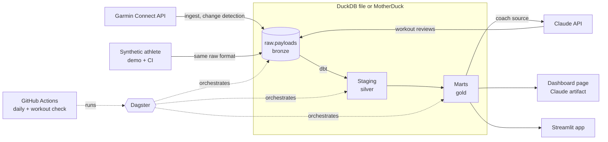

# garmin_project

A personal data platform for training data. It ingests my Garmin Connect data into DuckDB or
MotherDuck, models it with dbt, orchestrates it with Dagster, has Claude review every workout, and
serves it all in a live training dashboard: a single HTML page published as a Claude artifact,
plus a Streamlit app for local use.

It is a real, daily-used pipeline, built the way I would build one at work: raw data kept as an
append-only, replayable bronze layer, every transformation in tested dbt models, refreshes that run
in the cloud without a password, and CI that runs the whole pipeline on synthetic data.


*The running calendar of the Streamlit app, here on the synthetic demo athlete.*

## What it does

- **Keeps itself up to date.** A GitHub Actions workflow refreshes MotherDuck every morning, and
  through the day checks Garmin every 30 minutes for a new workout, so a workout is in the
  dashboard within about 45 minutes of the watch syncing. No machine of mine needs to be on.
- **Reviews every workout.** Claude judges each new session the way a coach would the same
  evening: what it actually was, whether it fit the recent load and recovery, how it compares with
  similar runs, and what to do next.
- **Serves a live dashboard.** One self-contained page, organised in tabs:

  | Tab | What it shows |
  |---|---|
  | **Today** | Status tiles (training status, readiness, VO2 max, resting heart rate, race prediction, weight), the latest workout review, and a coach's read: recovery, intensity balance, aerobic efficiency, load progression, long run, endurance, sleep, consistency, training paces and next week. |
  | **Training** | A race goal with a race-day projection, prediction, volume, VO2 max and load charts, a week-by-week training plan with a reason for every session, and the weekly review. |
  | **Nutrition** | A weight goal and a day-by-day meal plan. The page sets each day's energy and macro targets from Garmin's measured burn, the weight trend and the planned sessions, within fixed safety limits; Claude writes meals for those targets, with macros per meal and day and week totals. |
  | **History** | One period filter (3, 6 or 12 months) over summary tiles against the period before, volume per month or week, a daily training load heatmap, pace per run with its trend, resting heart rate, HRV and weight, when you train, run distances, time per activity, records, a filterable activity log, and a day-by-day calendar of runs and weigh-ins. |
  | **About** | How the pipeline works and how fresh each metric is. |

  The page holds no data: when opened on claude.ai it queries the marts through the viewer's
  MotherDuck connector, and keeps the race goal, weight goal and meal plan in the artifact's own
  database.

## Architecture



| Layer | What it is |
|---|---|
| **Ingest** | One pluggable `Source` per system, registered in [`sources/__init__.py`](src/garminreader/ingest/sources/__init__.py). The Garmin source makes one record per API call and keeps the payload untouched. The coach source reads the marts, asks Claude to review each workout without a review, and stores the answer the same way. A source only fetches; it never transforms. |
| **Bronze** | Append-only `raw.payloads` (payload and params as JSON, plus load metadata) and a `raw.loads` run log. A record is stored only when it is new or changed, and a load commits with its run-log row in one transaction. Every model can be rebuilt from this table. |
| **Silver, gold** | dbt on DuckDB. Staging keeps the newest version of each record. Marts: daily health, daily energy, activities, body composition, race results with personal bests, race predictions, workout reviews, current status, heart rate zones, and data freshness reports. Every model has data tests, plus a dbt unit test for race detection. |
| **Orchestration** | Dagster: raw ingest as daily partitions (backfill or rerun any day), each dbt model as an asset with its tests as checks, the review step between the two halves of dbt (Dagster splits the dbt run around it), and freshness checks. |
| **Serving** | The dashboard page ([`snapshot/`](src/garminreader/snapshot/)) and the Streamlit app ([`dashboard/`](src/garminreader/dashboard/)), both reading marts only. |

## Engineering choices worth a look

- **An append-only raw layer.** Change detection compares each payload with the latest stored
  version of the same source, endpoint and params, so overlapping re-fetches store nothing new
  while real changes are kept as history ([storage.py](src/garminreader/ingest/storage.py)).
- **AI output as a source.** Claude's reviews land in `raw.payloads` like any API response and are
  modelled by dbt, so a review is written once, kept, and traceable to the model and prompt version
  that wrote it ([coach/](src/garminreader/ingest/sources/coach/)).
- **Numbers by code, words by Claude.** The meal plan's energy and macro targets are computed in
  the page from measured data with fixed limits (weekly weight change, an intake floor, the largest
  deficit); Claude only turns them into meals.
- **A synthetic athlete in the exact API format.** A simulated year of training (fitness and
  fatigue, VO2 max, race times from Daniels' VDOT formulas, an illness, two half marathons) written
  as raw Garmin records, so the real loader, every dbt model and both front ends run on it
  unchanged. A contract test fails if the real source gains an endpoint the generator does not
  cover ([synthetic/](src/garminreader/synthetic/)).
- **Real and demo data kept apart.** `DATA_PROFILE=prod|demo`. The demo reads `DEMO_*` settings
  only, and real ingest refuses to run in demo, so the public demo can never contain personal data.
- **Cloud refreshes without a password.** The workflow only resumes a Garmin session created on my
  own machine and writes a refreshed session back to its secret; it never tries a password login,
  which is what makes Garmin ask for MFA or lock an account.

## Run it

You need Python 3.12+ and [uv](https://docs.astral.sh/uv/).

**Demo, no Garmin account needed:**

```sh
uv sync
export DATA_PROFILE=demo
uv run synthesize        # a simulated year of a runner, as raw Garmin responses
uv run transform         # dbt build: models and tests
uv run snapshot          # the dashboard page with the data embedded: data/demo/snapshot.html
uv run dashboard         # or the Streamlit app
```

**Your own Garmin data:**

```sh
cp .env.example .env     # GARMIN_EMAIL, GARMIN_PASSWORD; optionally DATABASE=md:garmin, MOTHERDUCK_TOKEN, ANTHROPIC_API_KEY
uv run doctor            # checks Garmin, the database, dbt and Anthropic
uv run pipeline          # ingest, workout reviews, dbt build and checks, as the scheduled run does
uv run dashboard
```

### Commands

| Command | What it does |
|---|---|
| `uv run ingest garmin [--since YYYY-MM-DD]` | Garmin into `raw.payloads`; without `--since`, resumes from the last load minus a day. |
| `uv run ingest coach [--since YYYY-MM-DD]` | Claude reviews workouts without a review (the last 7 days, or from `--since`; at most 5 a run). |
| `uv run transform [dbt args]` | dbt against the configured database; `build` by default. |
| `uv run pipeline [--partition YYYY-MM-DD]` | The Dagster job in process: ingest, reviews, dbt build, checks. |
| `uv run dagster dev` | The Dagster UI: lineage, partitions, backfills, check results. |
| `uv run snapshot [--live] [--days N] [--out PATH]` | The dashboard page. `--live` embeds no data and queries MotherDuck when opened (see below). |
| `uv run dashboard` | The Streamlit app. |
| `uv run doctor` | Checks every connection; exits non-zero on a failure. |
| `uv run workout-check` | Prints `new=true` when Garmin's newest activity is not stored yet. |
| `uv run garmin-tokens login\|export` | Creates the Garmin session on your machine, and prints it for the `GARMIN_TOKENS` secret. |
| `uv run explore` | The DuckDB UI on a snapshot of a local database. |
| `DATA_PROFILE=demo uv run synthesize [--days 365] [--seed 42]` | Rebuilds the demo database. |

### The dashboard page as a Claude artifact

```sh
uv run snapshot --live --out data/snapshot.html
```

Publish that file as a claude.ai artifact with the capabilities `mcp` (MotherDuck, tool `query`),
`db` (rule: `settings` read by viewers, written by editors), `user` and `sample`. The page then runs
one query per section through the viewer's MotherDuck connector each time it opens and every 15
minutes while open, so new data appears without republishing. Republish only when the page's code
changes.

## Scheduled refresh

[`.github/workflows/refresh.yml`](.github/workflows/refresh.yml) runs on GitHub's servers against
MotherDuck:

- **Daily refresh** at 04:17 UTC (about 06:00 in Amsterdam): ingest of that day and the day before
  (about 18 Garmin calls), workout reviews, dbt build and checks.
- **Workout check** every 30 minutes: `uv run workout-check` asks Garmin for the newest activity
  and the run continues into the full refresh only when `raw.payloads` lacks it. To keep calls to
  Garmin few, a check asks nothing outside 06:00 to 22:00 in Amsterdam, or once a workout from
  today is stored; the next morning's refresh picks up a second one. At most about 100 calls a
  day, far fewer on a day with an early workout. A failed check shows a warning rather than
  failing, so a broken session fails the daily run once instead of every check.
- **By hand** from the Actions tab, optionally for one day.

GitHub can start scheduled runs late when busy, and pauses the schedules of a public repository
after 60 days without commits (re-enable them from the Actions tab). Runner minutes are free for a
public repository.

### One-time setup

Repository secrets (Settings > Secrets and variables > Actions):

| Secret | What it is |
|---|---|
| `GARMIN_TOKENS` | The Garmin session: `uv run garmin-tokens login`, then `uv run garmin-tokens export \| gh secret set GARMIN_TOKENS` (or paste the export). |
| `MOTHERDUCK_TOKEN` | A MotherDuck access token. |
| `SECRETS_TOKEN` | A [fine-grained personal access token](https://github.com/settings/personal-access-tokens) for this repository only, with *Secrets: Read and write*, so the workflow can save a session Garmin refreshed. |
| `ANTHROPIC_API_KEY` | Optional: switches on the workout reviews. |

Do not add `GARMIN_EMAIL` or `GARMIN_PASSWORD` as secrets: without them no workflow can even try a
password login. Optional repository variables: `DATABASE` (default `md:garmin`) and
`REFRESH_RUNNER` (default `ubuntu-latest`).

When a run fails with "No working Garmin session", renew it with the two `garmin-tokens` commands.
Expect that about once a year, or after a password change.

### If Garmin pushes back

There is no official Garmin API for personal accounts; this uses the same unofficial endpoints as
the Garmin Connect app. The setup keeps the risk low (no password logins from the cloud, backoff on
rate limits, few calls), but Garmin could rate-limit or refuse GitHub's IP addresses. Then run the
same workflow on a machine at home: [add a self-hosted runner](https://docs.github.com/en/actions/hosting-your-own-runners/managing-self-hosted-runners/adding-self-hosted-runners)
(it needs uv and the GitHub CLI) and set the repository variable `REFRESH_RUNNER` to
`self-hosted`. GitHub keeps scheduling, logging and alerting; only the Garmin calls come from your
own connection.

## Quality

```sh
uv run ruff check . && uv run ruff format --check . && uv run mypy && uv run pytest
```

- **Python:** fully typed (`mypy --strict`). Tests cover the raw store's guarantees, the Garmin
  source (retries, 404s, windows), the workout check, the coach source (selection, cap, failures),
  the synthetic contract, the Dagster definitions, the dashboard page's queries, and the dashboard's
  coaching logic.
- **CI on every pull request:** the checks above, and the pipeline end to end on synthetic data.

## Layout

```
src/garminreader/
  ingest/          sources (Garmin, coach), the raw store, the ingest CLI, the workout check
  synthetic/       the simulated athlete and its Garmin-shaped payloads
  orchestration/   Dagster assets, checks, schedule, the pipeline CLI
  snapshot/        the dashboard page: template, one script per tab feature, live or embedded data
  dashboard/       the Streamlit app; queries.py is its only database access
  claude.py        the one Claude API client
  config.py        every setting, from .env
  db.py            connections to the local file or MotherDuck
transform/         dbt project: staging/ and marts/
.github/workflows/ CI and the refresh
```

## Stack

Python 3.12 · uv · python-garminconnect · DuckDB / MotherDuck · dbt-duckdb · Dagster with
dagster-dbt · Claude API · Claude artifacts · Streamlit · Plotly · GitHub Actions

## Roadmap

- TrainMore gym visits (check-in and check-out) as a second source, combined with Garmin recovery
  and training load.
- Possibly Strava, including matching activities seen by both Garmin and Strava.

## Notes

This project uses the unofficial [python-garminconnect](https://github.com/cyberjunky/python-garminconnect)
library and is not affiliated with Garmin. Training suggestions, workout reviews and meal plans
come from data patterns and Claude; they are estimates, not medical, nutritional or coaching advice.
